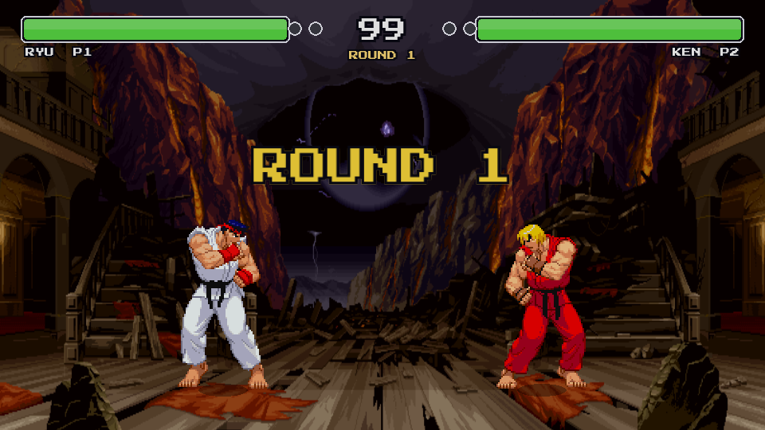
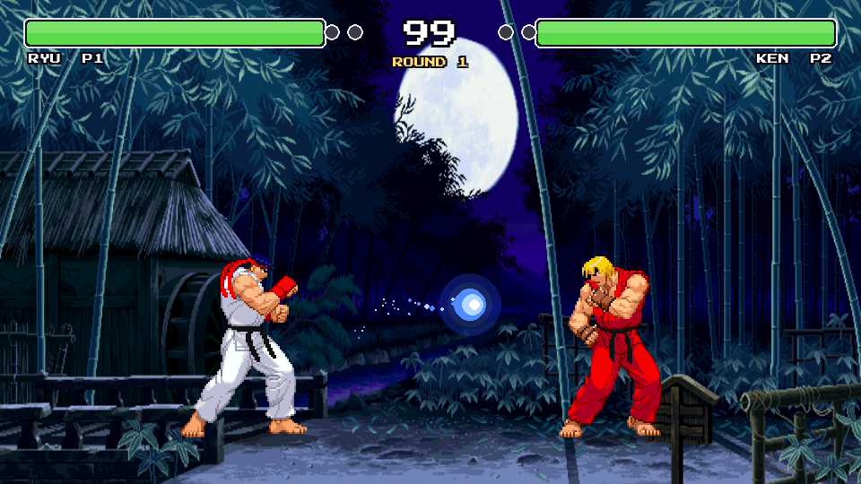
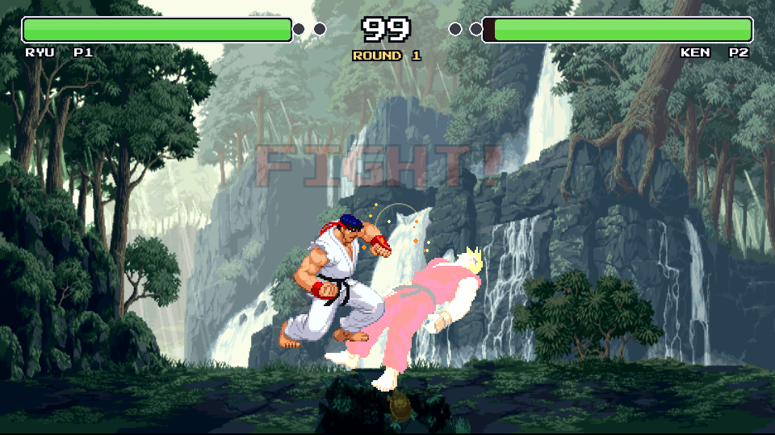
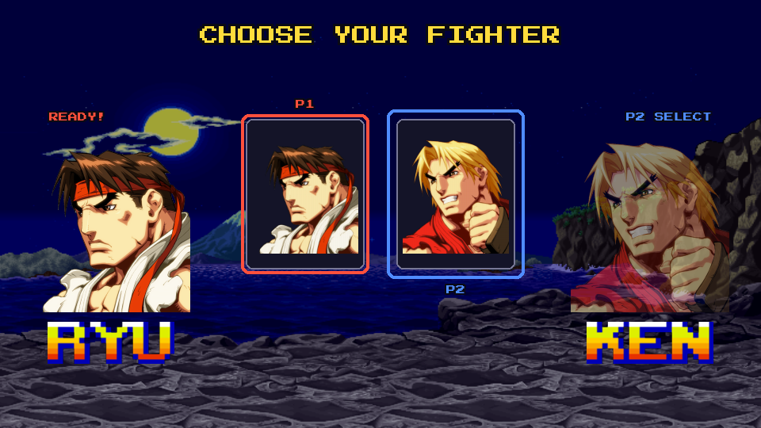

# 🥊 Street Fighter — Python Edition

A 2D fighting game inspired by Street Fighter, built with **pygame-ce**.
Local two-player battles with Ryu and Ken, six animated stages, motion-input
special moves (Hadouken! Shoryuken!), and a combat system with real frame
data, hitboxes, and cancels.


<p align="center">
  
  
  
  
</p>

## 🚀 Quick start

```bash
git clone <this-repo>
cd street-fighter-python
pip install -r requirements.txt
python main.py
```

Requires Python 3.10+. Dependencies: `pygame-ce`, `pillow`.

## ✨ Features

- **Two fighters** — Ryu and Ken, with full sprite animation sets
- **Special moves** — Hadouken (↓ ↘ → + P) fires a glowing projectile
  (blue for Ryu, orange for Ken); Shoryuken (→ ↓ → + P) is a rising
  knockdown uppercut with landing lag on whiff. Fireballs cancel each other
  when they collide.
- **Real fighting-game combat** — per-attack hitboxes with startup/active
  frames, hitstun/blockstun, chip damage, knockdowns on heavies,
  light-attack cancels into specials, combo counter
- **Crouching** — hold down to crouch: high attacks whiff over you, and
  crouching gives you low punches and a sweep that knocks down
- **Six animated stages** + animated character-select screen
- **Game feel** — hitstop, screen shake, particle hit sparks, KO slow
  motion, health bars with damage trails, springy announcer text
- **Deterministic engine** — fixed 60 Hz tick for physics, animation and
  combat; vsync'd rendering

## 🎮 Controls

|             | Player 1 | Player 2 |
|-------------|----------|----------|
| Move        | A / D    | ← / →    |
| Jump        | W        | ↑        |
| Crouch      | S        | ↓        |
| Light punch | J        | Numpad 4 |
| Heavy punch | K        | Numpad 5 |
| Light kick  | U        | Numpad 1 |
| Heavy kick  | I        | Numpad 2 |
| Block       | L (hold) | Numpad 6 (hold) |

### Moves

| Move | Input |
|------|-------|
| Hadouken | ↓ ↘ → + any punch |
| Shoryuken | → ↓ → + any punch |
| Uppercut | forward + heavy punch |
| Flip jump | jump + direction |
| Low punch | crouch + punch (cancels into specials on hit) |
| Sweep | crouch + kick (knocks down) |
| Air attacks | any attack while airborne |

High punches whiff over crouching opponents — mix in lows! `ESC` pauses and
shows the full move list. After a match: `R` to rematch, `ENTER` for menu.

## 📁 Project structure

```
street-fighter-python/
├── main.py              # window + vsync'd fixed-timestep game loop
├── assets/              # sprites, stages, sounds, music, font
└── sf/
    ├── config.py        # all tunable constants (speed, damage, health...)
    ├── assets.py        # data-driven sprite sheet loader, GIF stages
    ├── data/characters.json  # every animation: file, frames, timing
    ├── animation.py     # tick-based animation player
    ├── combat.py        # attack frame data + special move definitions
    ├── fighter.py       # physics, input buffer, hit reactions, boxes
    ├── effects.py       # particles, fireballs, screen shake
    ├── ui.py            # health bars, timer, combos, announcer
    └── scenes.py        # menu → char select → stage select → fight
```

Adding a character is data-driven: drop sprite sheets in `assets/images/<name>/`
and describe them in `sf/data/characters.json` — no engine changes needed.

## 🗺️ Roadmap

- [ ] AI opponent for single player
- [ ] More characters
- [ ] Online multiplayer (rollback-friendly: the engine is already deterministic)
- [ ] Training mode

## 🙏 Acknowledgments

- Inspired by Capcom's Street Fighter series
- Sprite assets from [OpenGameArt](https://opengameart.org/), sounds from
  [FreeSound](https://freesound.org/)
- Originally built in JavaFX by the same authors; this is the Python rewrite

## 👨‍💻 Authors

- [Kabir](https://github.com/daicarus)
- [Nihan](https://github.com/Nihan2609)

**Made with ❤️ and 🐍 by Nihan & Kabir**
